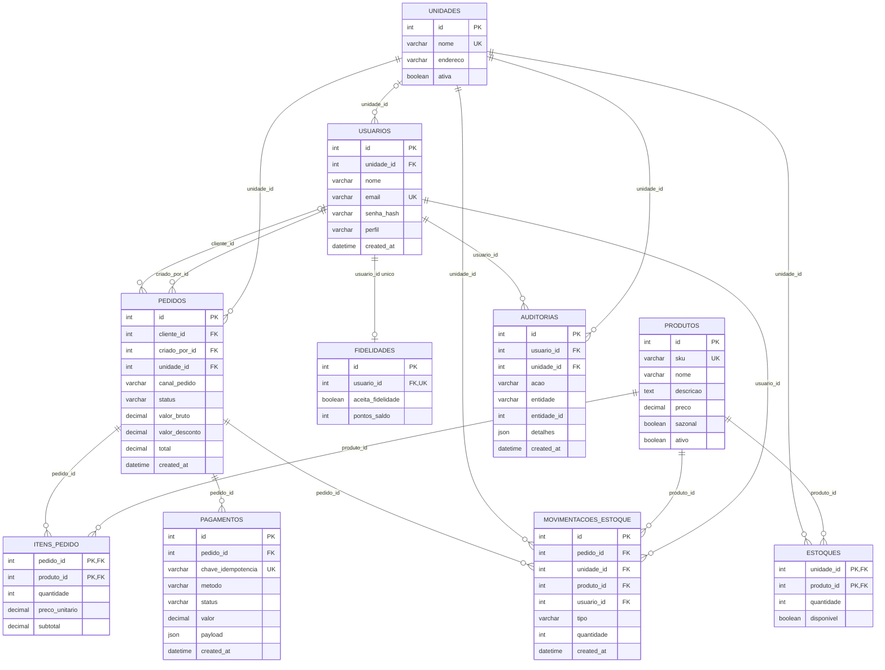
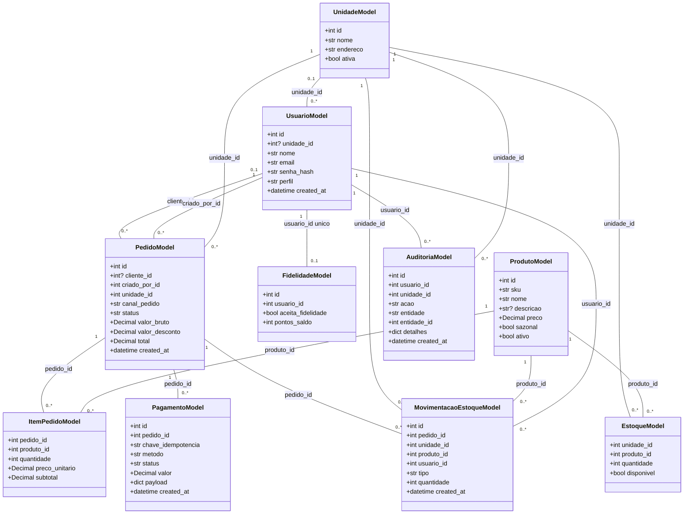

# Modelagem do banco de dados

Os diagramas abaixo refletem as tabelas criadas pelas migrations Alembic e as
classes SQLAlchemy em `src/infrastructure/database/models.py`.

## Diagrama entidade-relacionamento

## Diagrama de classes

